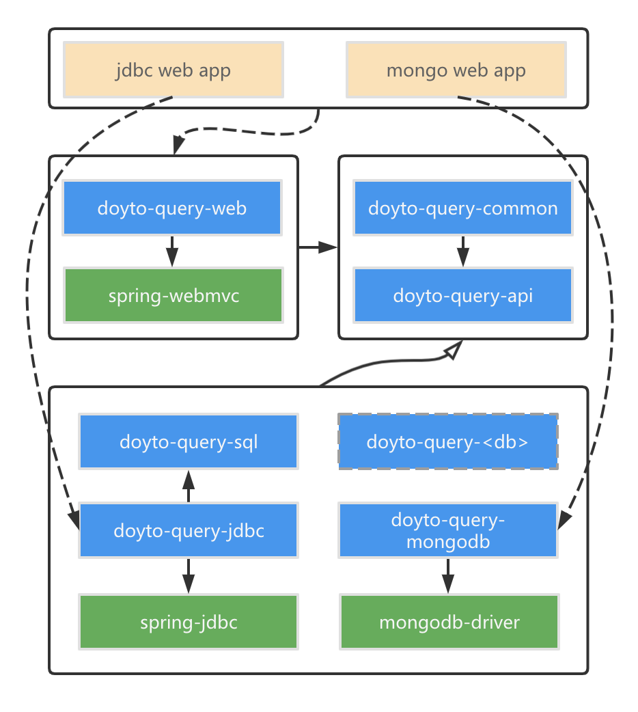

[](https://www.apache.org/licenses/LICENSE-2.0.html)
[](https://sonarcloud.io/dashboard?id=win.doyto%3Adoyto-query)
[](https://sonarcloud.io/component_measures?id=win.doyto%3Adoyto-query&metric=ncloc)
[](https://sonarcloud.io/component_measures?id=win.doyto%3Adoyto-query&metric=coverage)

DoytoQuery - 极简增删查改框架
---

## 简介

DoytoQuery 实现了一种动态查询语言，可以通过对象生成查询语句。
实体/视图对象用于生成表名和列名，
而查询/条件对象则用于动态生成查询条件。
查询对象中定义的每个字段都代表一个查询条件。在执行查询时，
被赋值的字段所对应的查询条件会被组合成查询子句，
从而通过与实体/视图对象的结合，完成 SQL 语句的动态构建。

更多详情请参阅 https://query.docs.doyto.win/
## 快速开始

1. 在Spring Initializer上初始化项目，包含以下4个依赖：
    * Lombok
    * Spring Web
    * Validation
    * \[数据库驱动]

2.  在 pom.xml 中添加 DoytoQuery 依赖：
```xml
<dependency>
    <groupId>win.doyto</groupId>
    <artifactId>doyto-query-jdbc</artifactId>
    <version>2.1.0</version>
</dependency>
<dependency>
    <groupId>win.doyto</groupId>
    <artifactId>doyto-query-web</artifactId>
    <version>2.1.0</version>
</dependency>
<dependency>
    <groupId>win.doyto</groupId>
    <artifactId>doyto-query-dialect</artifactId>
    <version>2.1.0</version>
</dependency>
```

3.  为一张表定义实体对象和查询对象：
```java
@Getter
@Setter
@Entity(name = "user")
public class UserEntity extends AbstractPersistable<Long> {
    private String username;
    private Integer age;
    private Boolean valid;
}

@Getter
@Setter
@SuperBuilder
@NoArgsConstructor
@AllArgsConstructor
public class UserQuery extends PageQuery {
    private String username;
    private Integer ageGe;
    private Integer ageLt;
    private Boolean valid;
}
```

在`UserService`中调用方法 [`DataAccess#query(Q)`](https://github.com/doytowin/doyto-query/blob/main/doyto-query-api/src/main/java/win/doyto/query/core/DataAccess.java):
```java
@Service
public class UserService extends AbstractCrudService<UserEntity, Long, UserQuery> {
    public List<UserEntity> findValidAdultUsers() {
        UserQuery userQuery = UserQuery.builder().ageGe(20).valid(true).pageSize(10).build();
        // Executed SQL: SELECT username, email, valid, id FROM t_user WHERE age >= ? AND valid = ? LIMIT 10 OFFSET 0
        // Parameters  : 20(java.lang.Integer), true(java.lang.Boolean)
        return dataAccess.query(userQuery);
    }
}
```

定义一个控制器来支持RESTful API：
```java
@RestController
@RequestMapping("user")
public class UserController extends AbstractEIQController<UserEntity, Long, UserQuery> {
}
```

将`logging.level.org.springframework.web.servlet.mvc.method.annotation.RequestMappingHandlerMapping`的日志级别设置为`trace`。
启动Spring Boot应用后，可以在控制台看到为`/user/`路径注册的RESTful接口：

```
s.w.s.m.m.a.RequestMappingHandlerMapping : 
	w.d.q.d.m.u.UserController:
	{PUT [/user/{id}]}: update(Persistable)
	{DELETE [/user/{id}]}: remove(Serializable)
	{GET [/user/{id}]}: get(Serializable)
	{DELETE [/user/]}: delete(DoytoQuery)
	{PATCH [/user/]}: patch(Object,DoytoQuery)
	{GET [/user/]}: page(DoytoQuery)
	{POST [/user/]}: create(List)
	{PATCH [/user/{id}]}: patch(Object)
```

更多示例请参考[demo](https://github.com/doytowin/doyto-query-demo).

## 架构图



## 版本

| 模块                     | Snapshot                                                                                                                                     | Release                                                                                             |
|------------------------|----------------------------------------------------------------------------------------------------------------------------------------------|-----------------------------------------------------------------------------------------------------|
| doyto-query-api        | [![api-snapshots-img]](https://central.sonatype.com/service/rest/repository/browse/maven-snapshots/win/doyto/doyto-query-api/)               | [![api-release-img]](https://central.sonatype.com/artifact/win.doyto/doyto-query-api)               |
| doyto-query-geo        | [![geo-snapshots-img]](https://central.sonatype.com/service/rest/repository/browse/maven-snapshots/win/doyto/doyto-query-geo/)               | [![geo-release-img]](https://central.sonatype.com/artifact/win.doyto/doyto-query-geo)               |
| doyto-query-common     | [![common-snapshots-img]](https://central.sonatype.com/service/rest/repository/browse/maven-snapshots/win/doyto/doyto-query-common/)         | [![common-release-img]](https://central.sonatype.com/artifact/win.doyto/doyto-query-common)         |
| doyto-query-sql        | [![sql-snapshots-img]](https://central.sonatype.com/service/rest/repository/browse/maven-snapshots/win/doyto/doyto-query-sql/)               | [![sql-release-img]](https://central.sonatype.com/artifact/win.doyto/doyto-query-sql)               |
| doyto-query-jdbc       | [![jdbc-snapshots-img]](https://central.sonatype.com/service/rest/repository/browse/maven-snapshots/win/doyto/doyto-query-jdbc/)             | [![jdbc-release-img]](https://central.sonatype.com/artifact/win.doyto/doyto-query-jdbc)             |
| doyto-query-web-common | [![web-common-snapshots-img]](https://central.sonatype.com/service/rest/repository/browse/maven-snapshots/win/doyto/doyto-query-web-common/) | [![web-common-release-img]](https://central.sonatype.com/artifact/win.doyto/doyto-query-web-common) |
| doyto-query-web        | [![web-snapshots-img]](https://central.sonatype.com/service/rest/repository/browse/maven-snapshots/win/doyto/doyto-query-web/)               | [![web-release-img]](https://central.sonatype.com/artifact/win.doyto/doyto-query-web)               |
| doyto-query-dialect    | [![dialect-snapshots-img]](https://central.sonatype.com/service/rest/repository/browse/maven-snapshots/win/doyto/doyto-query-dialect/)       | [![dialect-release-img]](https://central.sonatype.com/artifact/win.doyto/doyto-query-dialect)       |

## 支持的数据库：

- MySQL
- Oracle
- SQL Server
- PostgreSQL
- SQLite
- HSQLDB

## 开源协议

该项目基于 [Apache Licence v2](https://www.apache.org/licenses/LICENSE-2.0).

[geo-snapshots-img]: https://img.shields.io/nexus/s/win.doyto/doyto-query-geo?color=blue&server=https%3A%2F%2Foss.sonatype.org
[geo-release-img]: https://img.shields.io/maven-central/v/win.doyto/doyto-query-geo?color=brightgreen
[api-snapshots-img]: https://img.shields.io/nexus/s/win.doyto/doyto-query-api?color=blue&server=https%3A%2F%2Foss.sonatype.org
[api-release-img]: https://img.shields.io/maven-central/v/win.doyto/doyto-query-api?color=brightgreen
[common-snapshots-img]: https://img.shields.io/nexus/s/win.doyto/doyto-query-common?color=blue&server=https%3A%2F%2Foss.sonatype.org
[common-release-img]: https://img.shields.io/maven-central/v/win.doyto/doyto-query-common?color=brightgreen
[sql-snapshots-img]: https://img.shields.io/nexus/s/win.doyto/doyto-query-sql?color=blue&server=https%3A%2F%2Foss.sonatype.org
[sql-release-img]: https://img.shields.io/maven-central/v/win.doyto/doyto-query-sql?color=brightgreen
[jdbc-snapshots-img]: https://img.shields.io/nexus/s/win.doyto/doyto-query-jdbc?color=blue&server=https%3A%2F%2Foss.sonatype.org
[jdbc-release-img]: https://img.shields.io/maven-central/v/win.doyto/doyto-query-jdbc?color=brightgreen
[web-common-snapshots-img]: https://img.shields.io/nexus/s/win.doyto/doyto-query-web-common?color=blue&server=https%3A%2F%2Foss.sonatype.org
[web-common-release-img]: https://img.shields.io/maven-central/v/win.doyto/doyto-query-web-common?color=brightgreen
[web-snapshots-img]: https://img.shields.io/nexus/s/win.doyto/doyto-query-web?color=blue&server=https%3A%2F%2Foss.sonatype.org
[web-release-img]: https://img.shields.io/maven-central/v/win.doyto/doyto-query-web?color=brightgreen
[dialect-snapshots-img]: https://img.shields.io/nexus/s/win.doyto/doyto-query-dialect?color=blue&server=https%3A%2F%2Foss.sonatype.org
[dialect-release-img]: https://img.shields.io/maven-central/v/win.doyto/doyto-query-dialect?color=brightgreen
